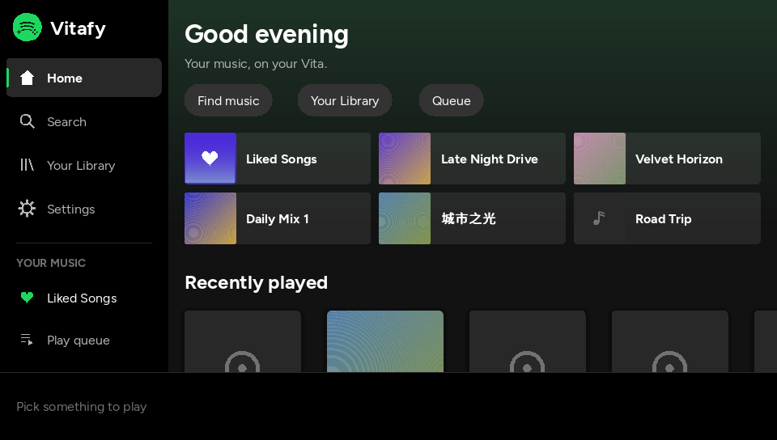

# Vitafy


An unofficial native Spotify client for the PS Vita, with a desktop-inspired
interface, a persistent player and song/artist notifications.

**Current release: [Vitafy 0.1.0](https://github.com/SpeedyNabz/Vitafy/releases/tag/v0.1.0).**
The user confirmed the preview.7 Home build works as intended; that exact binary
is promoted unchanged. Automated checks and user-reported device acceptance are
recorded separately.



## Features

- Labelled sidebar, Home shelves, search, Your Library and Liked Songs.
- Playlist sidebar and folder navigation; all seven playlist sort choices,
  stacked library filters, sorting dropdowns and back/forward. Playlist pages
  automatically load every available song in list view. Your Library uses the
  same simple list controls with category chips and a sorting dropdown.
- Best available source selection prefers lossless, with optional Medium (160 kbps)
  and Low (96 kbps) bandwidth limits. Vita PCM output remains 16-bit.
- Shared hearts across playlist and song views, acknowledged writes, rollback
  and periodic account reconciliation; private playlist create/rename/append, guarded entry removal/reordering and
  explicit queue edits. Pins and collapsed folders persist on this Vita.
  Read the [implementation status and remaining limits](docs/desktop-ui-audit.md).
- Account-scoped persistent browse metadata, snapshot reuse and bounded LRU caches;
  configurable 16/32 MiB browse storage and an acknowledged clear action.
- Sorted playback for up to 10,000 playable entries through cancellable chunk upload,
  with an explicit original-order fallback and bounded Connect queue windows.
- Optional screen dim/off timers default to Never; Home retains shell display policy.
- Full-screen touch/controller keyboard for search and playlist names, avoiding the system overlay.
- Persistent playback, seek and volume controls; shuffle, repeat and queue.
- Album/artist navigation, saving music, context menus and lyrics inherited
  through the existing frontend/backend contract.
- Song/artist track-change notifications, Unicode handling, skip coalescing,
  an in-app toast and a persistent notification switch.
- Vita sound-wave branding and LiveArea art, lifecycle graphics gating,
  bounded library updates, pagination retry and an orderly Exit action.

Spotify Premium and the upstream unofficial playback protocol are required for
real playback. The desktop preview uses synthetic data and produces no audio.
Vitafy is not affiliated with or endorsed by Spotify or Sony.

Download the VPK from the [0.1.0 release](https://github.com/SpeedyNabz/Vitafy/releases/tag/v0.1.0).
See the [release notes](docs/releases/0.1.0.md) for installation, checks and known limits.

Development build **0.1.1-preview.1** addresses reported Bluetooth-volume jumps
and long skip buffering; see the [investigation and test-build notes](docs/bluetooth-volume-and-skip-buffering.md).
The released package above remains the user-accepted 0.1.0 build.

## Quick start: offline desktop preview

Install Git, Python 3.9+, CMake 3.24+ and a C compiler. Windows uses Visual Studio
2022 Build Tools with C++; Linux uses SDL development packages.

```sh
git clone https://github.com/SpeedyNabz/Vitafy.git
cd Vitafy
python -m pip install -r requirements-dev.txt
python scripts/build.py desktop
```

On Windows the script downloads and verifies pinned official SDL archives. On
Ubuntu, first install `build-essential cmake pkg-config libsdl2-dev
libsdl2-image-dev libsdl2-ttf-dev`. Build output is in `build/desktop/`; screenshots
and local verification are in `artifacts/mock-preview/`.

See [building](docs/building.md) for native VitaSDK/Rust builds and manual preview
launching. Build scripts do not install packages onto a Vita or read credentials.

## Source layout and attribution

Vitafy is based on [VitaSpot by 0oPerryo0](https://github.com/0oPerryo0/VitaSpot),
pinned at `81c533f1ef61623360ea4fbe32cf29b4f2f3901f`. This standalone repository
contains the reviewed Vitafy patch, new source files, assets, build tooling,
documentation and a source lock. `scripts/prepare.py` fetches that exact upstream
revision, applies the changes and verifies the prepared files in `build/source/`.
It does not depend on a separate PS Vita lab checkout.

The upstream root has no blanket frontend LICENSE at the inspected revision.
This repository does not assign upstream code a new license. The release retains
existing component/font notices; unresolved frontend/asset terms are recorded in
[attribution and licensing](THIRD_PARTY_NOTICES.md).

| Path | Purpose |
| --- | --- |
| `src/`, `tests/` | New notification code and tests |
| `patches/` | Reviewed frontend, lifecycle and backend changes |
| `overlays/`, `assets/brand/` | Package art, vector logo and preserved notices |
| `source-lock.json` | Upstream, SDK, Rust, dependency and source hashes |
| `scripts/`, `cmake/` | Preparation, build, test and package checks |
| `docs/` | Current guides, evidence, research and historical experiment ledger |
| `build/`, `.cache/`, `artifacts/`, `private/` | Ignored local/generated data |

## Documentation

- [Current status and evidence](docs/status.md)
- [Build and test guide](docs/building.md)
- [Install, update and device acceptance](docs/installing.md)
- [Architecture and notification behavior](docs/architecture.md)
- [Research index and historical experiments](docs/research-index.md)
- [Open work plan: app reliability and cross-app/game playback](docs/open-work-plan.md)
- [Current research findings](docs/research/current-findings.md)
- [Roadmap](docs/roadmap.md) and [contributing](CONTRIBUTING.md)
- [Private data and issue reports](SECURITY.md)

**Known lifecycle risk:** an earlier Home-resident build hung the shell when a
game forced it closed during playback. Do not repeat that transition. Vitafy
defaults to ordinary package attributes; game coexistence, service integration and
power/sleep support remain unverified. See [current status](docs/status.md).

The released Home profile is built with `--home-playback`; the default build
configuration remains foreground-only. The known game forced-close risk remains.
See [build instructions](docs/building.md).
